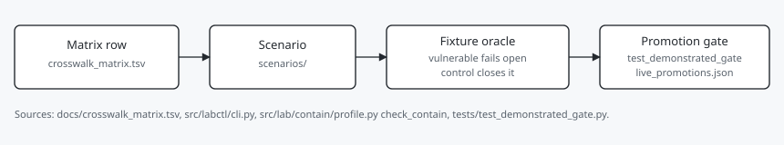

# owasp-dual-top10-lab

This lab asks which OWASP LLM and Agentic classes still fire when a surface is allowed. It pins each row to a CVE, an AIID entry, or a dated N/A, then executes a fixture oracle so the row is not a title alone.

The directory slugs are the **OWASP Top 10 for LLM Applications (2025)**, with **2026 edition as columns**, plus the **OWASP Top 10 for Agentic Applications for 2026** (dated **2025-12-09**). That Agentic list is not *State of Agentic AI Security and Governance* v2.01.

Author: [Landen Stecker](https://github.com/Steck43)

The floor is [capability-gate](https://github.com/Steck43/capability-gate). The atom plane and the judge are [aegis-atoms](https://github.com/Steck43/aegis-atoms). The box is [isolation-layer](https://github.com/Steck43/isolation-layer). This repo is the evidence plane: the classes that still fire when a surface is allowed. An earlier course lab is [newwave-owasp-security-lab](https://github.com/Steck43/newwave-owasp-security-lab).



## What you get

- `docs/crosswalk_matrix.tsv`: single write surface for OWASP ↔ ATLAS ↔ CVE ↔ AIID
- `scenarios/`: one directory per ID (LLM01–LLM10, ASI01–ASI10)
- `labctl`: list scenarios, check containment, run oracle paths
- Fixture oracles under `evidence/fixtures/` for every ID (vulnerable path + control path)
- Machine-gated live promotions via `evidence/receipts/live_promotions.json`

Containment is a declared policy profile before tool or filesystem scenarios run (synthetic workspace root; host credentials and egress opt-outs refused). It is not a network sandbox, and lab secrets are synthetic.

## Claim status

| Status | Meaning |
|--------|---------|
| Stub | Matrix row and scenario path only |
| Harnessed | Deterministic fixture: vulnerable path fails open, control closes it |
| Reproduced-in-lab | Live run against this lab, committed receipt + promotion index |
| Demonstrated | External primary evidence (CVE write-up, AIID with matching mechanism, vendor advisory). Building a toy and breaking it here does not count. |

Promote rules, process loop, research receipts, and the related Stage-1 gate live in [docs/claim_tense.md](docs/claim_tense.md), [docs/PROCESS.md](docs/PROCESS.md), [docs/RESULTS-2026-07-23.md](docs/RESULTS-2026-07-23.md), and [docs/related_capability_gate.md](docs/related_capability_gate.md).

## Status (derived from `docs/crosswalk_matrix.tsv`, 2026-10-20)

| | Count |
|--|------:|
| Matrix rows resolved (pin or dated N/A) | 20/20 |
| Harnessed | 19 |
| Reproduced-in-lab | 1 (LLM09) |
| Stub | 0 |
| Demonstrated | 0 |

`pytest tests/test_llm01_oracle.py` asserts each id's `scenario.yaml` oracle strings against `labctl` JSON, and a swapped pair must fail. That is not a live promotion. Nineteen rows remain canned fixtures. Do not refresh fixtures to green a red test. `check_crosswalk.py` refuses `Demonstrated` on a fixture capture.

The matrix has 20 of 20 rows resolved by a pin or a dated N/A. Nineteen stay Harnessed. LLM09 is Reproduced-in-lab against `gpt-3.5-turbo` with a committed capture under `evidence/receipts/live/` and `live_promotions.json` using a strict `MISINFO_OK` line scorer. CVE-2025-32711 remains the LLM01 pin. The 2026-09-12 CNA retrieve is cited in the searched note; it is not Demonstrated. CNA taxonomy is CWE-74. Building a toy and breaking it here still does not earn Demonstrated.

LLM01 live OpenAI output only described the inject marker, so that attempt stays demoted. Local gitignored captures under `evidence/captures/` remain for attempts, not promotions. ASI07/08/10 use a small multi-agent bus; ASI02/ASI05 require the contain profile; ASI04 shares the LLM03 install mechanism under agent-goal framing.

## Quick start

```bash
git clone https://github.com/Steck43/owasp-dual-top10-lab.git
cd owasp-dual-top10-lab
python -m venv .venv
# Windows: .venv\Scripts\activate
# Unix:    source .venv/bin/activate
pip install -e ".[dev]"
labctl list
labctl contain
pytest -q
labctl run LLM01
labctl run LLM08
labctl run ASI05
labctl run ASI09

# Live captures (keys via env only; writes gitignored evidence/captures/)
# GEMINI_API_KEY / ANTHROPIC_API_KEY / OPENAI_API_KEY
python scripts/live_capture.py --provider openai --ids LLM01,LLM09
```

## Repository layout

```
docs/crosswalk_matrix.tsv   # mapping SoT
docs/sources.md             # taxonomy pins and corpora
docs/claim_tense.md         # status ladder
docs/PROCESS.md             # harness → live → promote → demonstrate
scenarios/llm/              # LLM01–LLM10
scenarios/asi/              # ASI01–ASI10
src/lab/                    # reference agent pieces + contain profile
src/labctl/                 # CLI
evidence/fixtures/          # oracle captures for Harnessed rows
evidence/receipts/          # dated prove artifacts + live promotions
tests/                      # oracle + matrix checks
```

## Controls and status

| Control | Status | Proof |
|---|---|---|
| Fixture oracle per row | built and tested | `tests/test_llm01_oracle.py`; matrix status column |
| Promotion gate | built and tested | `tests/test_demonstrated_gate.py`; `evidence/receipts/live_promotions.json` |
| Containment profile | built and tested | `src/lab/contain/profile.py` `check_contain`. Refuses host credentials and egress opt-outs. Not a network sandbox. |
| Multi-agent bus for ASI07, ASI08, ASI10 | built and tested | `src/lab/agent/multiagent.py` |

## Where the controls live

This lab's own ladder is separate from the sibling controls. All ten ASI rows are Harnessed. None are Reproduced-in-lab or Demonstrated.

| Repo | Class | What it does | Label |
|---|---|---|---|
| capability-gate | ASI02 Tool Misuse and Exploitation | Deny by default on tool plus path | built and tested |
| capability-gate | ASI05 Unexpected Code Execution | Shell and code tools denied unless granted | built and tested |
| capability-gate | ASI01 Agent Goal Hijack | Limits impact. Does not detect a hijack | built and tested |
| capability-gate | ASI10 Rogue Agents | Kill switch denies the call | built and tested |
| aegis-atoms | ASI02, ASI03, ASI04, ASI05, ASI06, ASI01 with ASI09, ASI10 | Codes are tags in that tree | built and tested |
| isolation-layer | ASI05 Unexpected Code Execution | One microVM per task. Full path untested live | built and tested |

The crosswalk does not cover model extraction or ML evasion. The `eu_*` columns stay data. They are not a claim in this README.

## How to run

See Quick start. On this machine the proof command is `python -m pytest -q`. `labctl list`, `labctl contain`, and `labctl run LLM01` are the CLI verbs in `src/labctl/cli.py`.

## Known limits

- Demonstrated is 0. A fixture capture cannot earn that rung.
- LLM01's live attempt stayed demoted. LLM09 is the one Reproduced-in-lab row.
- Containment is a declared profile, not a network sandbox.
- No model-extraction or ML-evasion row is in the matrix.

## Related work

[newwave-owasp-security-lab](https://github.com/Steck43/newwave-owasp-security-lab) is an earlier course lab with live captures for seven LLM Top 10 IDs. This repo is a separate dual-framework research roof, not a fork of that tree.

- OWASP Top 10 for LLM Applications 2025. https://genai.owasp.org/resource/owasp-top-10-for-llm-applications-2025/. Borrows the taxonomy. `scenarios/llm/` has one directory per LLM01 through LLM10, under CC BY-SA 4.0.
- OWASP Top 10 for Agentic Applications for 2026. https://genai.owasp.org/resource/owasp-top-10-for-agentic-applications-for-2026/. Borrows the taxonomy. `scenarios/asi/` covers ASI01 through ASI10. ASI07, ASI08 and ASI10 run on the small bus.
- MITRE ATLAS. https://atlas.mitre.org/. Borrows technique IDs as a column.
- NIST NVD, CVE-2025-32711. https://nvd.nist.gov/vuln/detail/CVE-2025-32711. Tests against as the LLM01 pin. Cited, not Demonstrated.
- McGregor, S. (2020). The AI Incident Database. https://arxiv.org/abs/2011.08512. Borrows incident IDs from an offline snapshot that is not distributed with the repo.
- Greshake et al. (2023). Indirect prompt injection. https://arxiv.org/abs/2302.12173. Tests against the same class. The live LLM01 attempt stays demoted.
- Stecker, L. (2026). capability-gate. https://doi.org/10.5281/zenodo.22018052. Companion. The lab does not run the gate.

## License and attribution

OWASP Top 10 titles and structure are used under [CC BY-SA 4.0](https://creativecommons.org/licenses/by-sa/4.0/), remain under that license, and are not relicensed by this repository. Code here is authored by Landen Stecker; see [LICENSE](LICENSE).

Landen Stecker, agentic AI engineer and architect with security built in.
